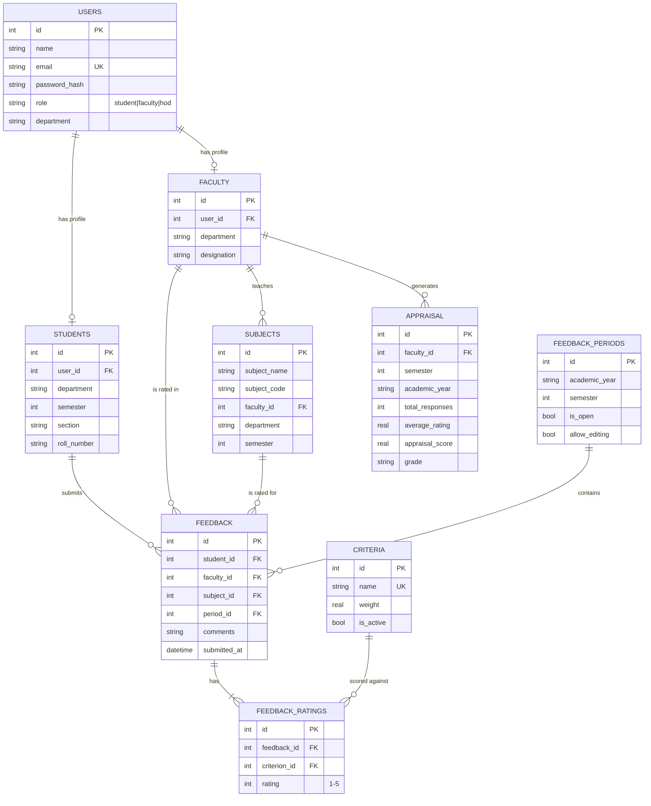

# System Architecture & Design Document

## 1. Problem Statement & Proposed Solution

Traditional semester-end faculty feedback is often paper-based or a bare
Google Form: aggregation is manual, there is no standardized scoring
method, and the HOD has no real visibility into trends across faculty,
subjects or semesters. This system centralizes collection, automatically
aggregates and analyzes responses, and turns raw ratings into an
auditable **appraisal score** with real analytics — without ever
exposing which student said what.

## 2. System Architecture

```
┌──────────────────┐        HTTPS/JSON         ┌───────────────────┐        SQL        ┌────────────┐
│   React SPA       │ ───────────────────────▶ │  Express REST API  │ ─────────────────▶ │  SQLite DB │
│  (Vite, Tailwind,  │ ◀─────────────────────── │  (JWT auth, role-   │ ◀───────────────── │ (better-   │
│   Recharts)        │        JSON               │   based middleware) │                    │  sqlite3)  │
└──────────────────┘                            └───────────────────┘                    └────────────┘
       │                                                  │
       │  localStorage: JWT + user profile                │  bcrypt password hashing
       ▼                                                  ▼
  Role-based routing                                appraisal.js — scoring engine
  (student / faculty / hod)                          (pure functions, no side effects
                                                       beyond the appraisal table)
```

- **Frontend** is a single-page app. Route access is gated client-side by
  `ProtectedRoute` (role check) and server-side by `authenticate` +
  `authorize(...roles)` middleware on every sensitive endpoint — the UI
  gate is a convenience, the API gate is the real security boundary.
- **Backend** follows a classic layered structure: `routes` (HTTP
  wiring) → `controllers` (request handling, validation) → `config/db.js`
  (data access) with a separate `utils/appraisal.js` holding the scoring
  logic so it can be unit-tested independently and reused by both the
  faculty-performance endpoint and the HOD appraisal endpoints.
- **Database** is SQLite for zero-config local/demo use; the schema is
  fully normalized ANSI SQL and would move to Postgres/MySQL with no
  structural changes — only the driver in `config/db.js` changes.

## 3. Database Schema (Entity Relationship)



Key integrity rules enforced at the database level:
- `UNIQUE(student_id, faculty_id, subject_id, period_id)` on `feedback` — a
  student cannot submit duplicate feedback for the same faculty/subject
  in the same collection period.
- `CHECK (rating BETWEEN 1 AND 5)` on `feedback_ratings`.
- `ON DELETE CASCADE` from `users` down through profiles, subjects and
  feedback, so removing a faculty/student account cleans up correctly.

## 4. User Flows

### Student
```
Login → Student Dashboard (subject list + completion bar)
      → Select subject → Rate every criterion (1–5) → optional comment
      → Submit → Confirmation screen → back to subject list
```
Duplicate submission is blocked unless the HOD has enabled editing for
the open period.

### Faculty
```
Login → My Performance
      → KPI cards (overall rating, appraisal score, responses, semester)
      → Radar chart (criterion-wise) · Trend line (semester-over-semester)
      → Rating distribution · How-it's-calculated panel · Anonymous comments
```
Faculty can only ever query their **own** `faculty_id` — enforced in
`facultyController.getPerformance` and `appraisalController.getAppraisal`,
independent of anything the frontend does.

### HOD / Admin
```
Login → Dashboard (KPIs, faculty comparison, criteria radar, semester trend, activity)
      → Faculty (list → drill into any faculty's full performance page)
      → Students (add/remove)
      → Appraisals (regenerate for a semester, ranked table with grade)
      → Reports (CSV export)
      → Settings (toggle criteria, edit the appraisal formula, open/close feedback window)
```

## 5. Page / Screen Structure

| Route | Role | Purpose |
|---|---|---|
| `/login` | public | Sign in |
| `/student` | student | Subject list + inline feedback form |
| `/faculty` | faculty | Own performance dashboard |
| `/hod` | hod | Main analytics dashboard |
| `/hod/faculty` | hod | Faculty list + management + drilldown into `/faculty`-style view |
| `/hod/students` | hod | Student list + management |
| `/hod/appraisals` | hod | Ranked appraisal table, regenerate button |
| `/hod/reports` | hod | CSV export |
| `/hod/settings` | hod | Criteria, formula config, feedback period control |

## 6. Feature List

- Role-based auth (student / faculty / HOD) with JWT + bcrypt
- Feedback submission with 10 configurable criteria, 1–5 scale, optional comments
- Duplicate-submission prevention, admin-toggleable editing window
- Automatic, transparent, configurable appraisal scoring
- HOD analytics: KPIs, faculty comparison bar chart, criteria radar,
  semester trend line, recent activity feed, department filter
- Faculty performance profile: radar, trend, rating distribution, anonymized comments
- Admin: manage faculty/students/subjects, configure criteria weights,
  open/close feedback periods, edit appraisal formula thresholds
- CSV report export
- Fully responsive (desktop sidebar, mobile bottom nav), loading/empty/error states throughout

## 7. API Architecture

All responses follow `{ success: boolean, message?, data? }`. All
non-auth routes require `Authorization: Bearer <token>`; role checks are
enforced server-side per route.

```
POST   /api/auth/login
GET    /api/auth/me

GET    /api/feedback/criteria          (student, faculty, hod)
GET    /api/feedback/targets           (student)
GET    /api/feedback/status            (student)
POST   /api/feedback                   (student)

GET    /api/faculty                    (any authenticated role)
GET    /api/faculty/:id
GET    /api/faculty/:id/performance    (faculty: own only, hod: any)

GET    /api/analytics/dashboard        (hod)
GET    /api/analytics/faculty          (hod)
GET    /api/analytics/criteria         (hod)
GET    /api/analytics/trend            (hod)
GET    /api/analytics/recent-activity  (hod)
GET    /api/analytics/filters          (hod)

GET    /api/appraisal/:facultyId       (faculty: own only, hod: any)
POST   /api/appraisal/generate         (hod)
GET    /api/appraisal/config           (hod)
PUT    /api/appraisal/config           (hod)

GET    /api/admin/students             (hod)
POST   /api/admin/students
DELETE /api/admin/students/:id
POST   /api/admin/faculty
DELETE /api/admin/faculty/:id
GET    /api/admin/subjects
POST   /api/admin/subjects
DELETE /api/admin/subjects/:id
GET    /api/admin/criteria
POST   /api/admin/criteria
PUT    /api/admin/criteria/:id
GET    /api/admin/periods
POST   /api/admin/periods/open
POST   /api/admin/periods/close
GET    /api/admin/reports/appraisal.csv
```

## 8. Appraisal Calculation Methodology

The scoring engine (`backend/utils/appraisal.js`) is deliberately simple
linear math — no black box — so it can be explained in a viva and
audited by the HOD.

**Step 1 — Criterion average.** For each active criterion, average every
rating it received for that faculty member in the given semester/year:

```
criterionAvg_i = Σ(ratings for criterion i) / count(ratings for criterion i)
```

**Step 2 — Weighted average rating.** Combine all criterion averages
using each criterion's configurable weight (defaults to 1.0, i.e. equal
weighting):

```
weightedAverage = Σ(criterionAvg_i × weight_i) / Σ(weight_i)
```

**Step 3 — Appraisal score.** Normalize against the configured rating
scale (default 1–5) into a 0–100 score:

```
appraisalScore = (weightedAverage / scaleMax) × 100
```

**Step 4 — Grade.** Compare the weighted average against two
HOD-configurable thresholds (defaults: 3.0 and 4.5):

```
weightedAverage ≥ excellentThreshold  → "Excellent"
weightedAverage ≥ passThreshold       → "Satisfactory"
otherwise                              → "Needs Improvement"
```

The score is recomputed on demand (`GET /api/appraisal/:facultyId`) and
persisted via `POST /api/appraisal/generate`, which upserts one row per
`(faculty_id, semester, academic_year)` — so historical appraisals are
preserved even as new feedback continues to arrive for a *different*
semester, giving the semester-trend charts real historical data.

## 9. Security & Privacy Measures

- Passwords hashed with bcrypt (never stored or returned in plaintext)
- JWT with 8-hour expiry; 401 responses clear client-side auth state
- Every protected route enforces role via server-side middleware, not
  just UI hiding
- Faculty can only query their own performance/appraisal — enforced by
  comparing the JWT's `profileId` to the requested `:id`, not by trusting
  the client
- Feedback responses are never joined back to a student identity in any
  faculty- or HOD-facing endpoint — only aggregates and anonymized
  comment text are returned
- Input validation on every write endpoint (required fields, rating
  range 1–5, valid faculty/subject pairing)
- Parameterized SQL throughout (via `better-sqlite3` prepared
  statements) — no string-built queries, so no SQL injection surface
